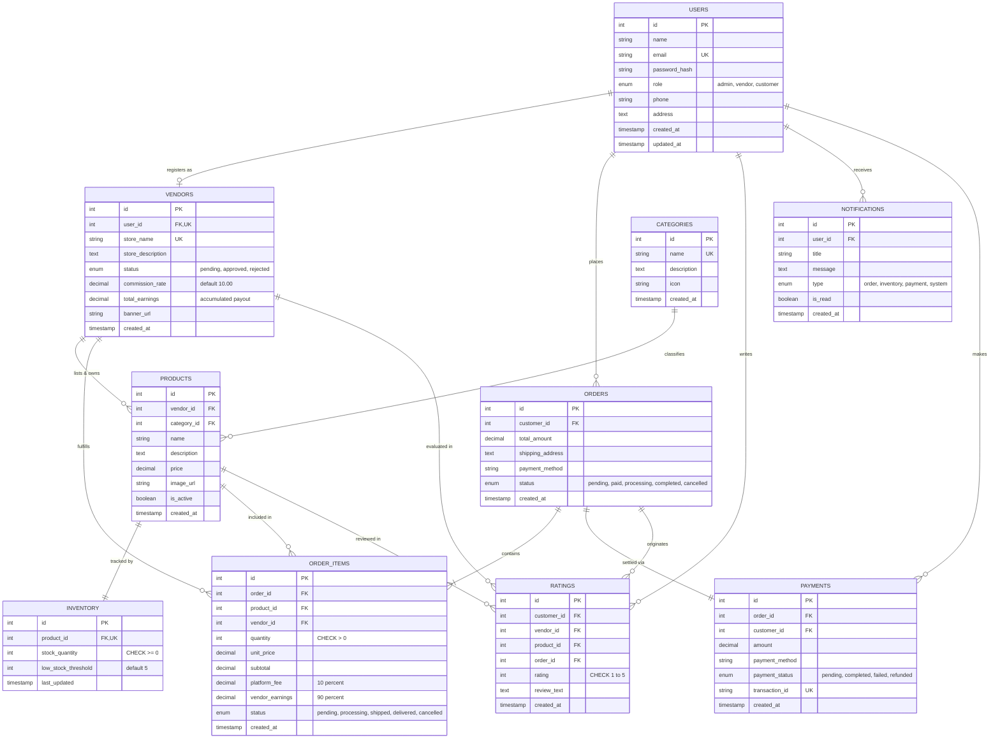

# 🛒 MarketHub - Multi-Vendor Management System (DBMS Project)

A complete, production-grade **Full-Stack Multi-Vendor Management System** designed for Database Management Systems (DBMS) coursework and real-world evaluation. Built with **Node.js + Express**, **MySQL 8.0+**, **HTML5/Tailwind CSS/ES6 JavaScript**, and **JWT Authentication with Bcrypt**.

---

## 🌟 Highlights & DBMS Features

- **Role-Based Access Control (RBAC)**: Distinct permissions and views for **Admin**, **Vendor**, and **Customer**.
- **Relational Integrity**: 10 normalized tables with primary keys, foreign keys (`ON DELETE CASCADE` / `RESTRICT`), check constraints, and performance indexes.
- **Automated MySQL Triggers**:
  - `trg_after_order_item_insert`: Automatically deducts inventory stock upon purchase, updates vendor cumulative earnings, and fires low-stock alert notifications if stock drops $\le$ threshold.
  - `trg_after_order_item_update`: Restores inventory stock and reverses vendor earnings upon item cancellation.
  - `trg_after_product_insert`: Automatically provisions an inventory record when a new product is listed.
- **Advanced MySQL Views**:
  - `vw_vendor_performance`: Calculates total orders, units sold, gross sales, 10% platform commission paid, net earnings, and average rating for each vendor.
  - `vw_low_stock_products`: Live audit of products running low on stock across all vendor stores.
  - `vw_monthly_platform_revenue`: Financial breakdown of gross merchandise value (GMV), 10% platform commission, and vendor payouts grouped by year-month.
  - `vw_order_full_details`: Consolidates orders, customers, items, products, and vendors into an analytical view.
- **MySQL Stored Procedures**: `sp_approve_vendor`, `sp_reject_vendor`, `sp_restock_product`.
- **Atomic Concurrency & Safe Inventory**: Database transactions (`START TRANSACTION`, `FOR UPDATE`, `COMMIT`, `ROLLBACK`) preventing overselling and race conditions.
- **Multi-Vendor Order Auto-Splitting**: A customer can order items from multiple independent vendors in a single cart. The order is automatically split into vendor fulfillment sub-items with isolated tracking.
- **Automated 10% Platform Commission**: Platform automatically deducts 10% fee from each subtotal; 90% is allocated to vendor payouts.
- **In-App Notification Center**: Instant alerts for incoming orders, low stock warnings, payments, and approvals.
- **Zero-Friction Evaluation Mode**: Includes an intelligent fallback in-memory relational store pre-seeded with sample data, enabling evaluators to run and test the complete system immediately even before MySQL is started!

---

## 📊 Entity-Relationship (ER) Diagram



---

## 🗄️ Database Tables Overview

| # | Table Name | Purpose & Primary Constraints |
|---|------------|--------------------------------|
| 1 | `users` | Role-based accounts (`admin`, `vendor`, `customer`). Unique email index. |
| 2 | `vendors` | Vendor store profiles, approval status (`pending`, `approved`, `rejected`), 10% commission rate, cumulative earnings. Foreign key to `users(id)` ON DELETE CASCADE. |
| 3 | `categories` | Product categorization hierarchy (`Electronics`, `Fashion`, `Home & Living`, etc.). |
| 4 | `products` | Vendor item catalog. Foreign keys to `vendors(id)` and `categories(id)`. |
| 5 | `inventory` | Real-time stock levels with `CHECK (stock_quantity >= 0)` and alert threshold. |
| 6 | `orders` | Master checkout header containing customer ID, delivery address, total amount. |
| 7 | `order_items` | Multi-vendor sub-orders recording `quantity`, `unit_price`, `platform_fee` (10%), and `vendor_earnings` (90%), with individual status tracking. |
| 8 | `payments` | Financial audit ledger tracking payment methods, status, and unique transaction IDs. |
| 9 | `ratings` | Customer reviews for delivered items. `CHECK (rating BETWEEN 1 AND 5)`. |
| 10 | `notifications` | System alerts for incoming orders, low stock warnings, payments, and approvals. |

---

## ⚡ Quick Start & Setup

### 1. Prerequisites
- **Node.js** (v18.x or v20.x+)
- **MySQL 8.0+** (optional for quick evaluation; required for full MySQL native execution)

### 2. Installation
Clone or navigate to the project directory:
```bash
cd multi-vendor-system
npm install
```

### 3. Configure Database Credentials
Edit `.env` (or copy from `.env.example`):
```env
PORT=5000
NODE_ENV=development
JWT_SECRET=super_secret_jwt_key_dbms_multivendor_2026
PLATFORM_COMMISSION_PERCENT=10

# MySQL Configuration
DB_HOST=127.0.0.1
DB_PORT=3306
DB_USER=root
DB_PASSWORD=
DB_NAME=multivendor_db
```

### 4. Initialize Database Schema & Seed Data (MySQL)
Run the automated schema and seed installer:
```bash
npm run db:init
```
This executes `database/schema.sql` (creating all 10 tables, constraints, foreign keys, triggers, views, and procedures) followed by `database/sample_data.sql`.

### 5. Launch the Web Application
```bash
npm start
```
Open your browser and navigate to:
👉 **`http://localhost:5000`**

---

## 🔑 Demo Accounts & Evaluation Credentials

For seamless evaluation, the web application includes a **Demo Quick-Login Bar** at the top of the page. You can switch roles with 1 click, or sign in manually with the following credentials:

| Role | Name / Store | Email | Password | Key Capabilities to Test |
|------|-------------|-------|----------|--------------------------|
| **Admin** | System Administrator | `admin@markethub.com` | `admin123` | Approve/Reject vendors, view platform 10% revenue, inspect `vw_vendor_performance`, audit low-stock items. |
| **Vendor** | TechZone Electronics | `tech@zone.com` | `password123` | Manage products, restock low items, view incoming orders, update fulfillment statuses (Pending $\rightarrow$ Shipped $\rightarrow$ Delivered). |
| **Vendor** | Urban Chic Apparel | `fashion@hub.com` | `password123` | Fulfill multi-vendor order items, monitor 90% net earnings. |
| **Vendor (Pending)** | Artisan Leather Crafts | `pending@artisan.com` | `password123` | Tests approval flow: Application is pending review; approved in Admin view. |
| **Customer** | Alice Walker | `alice@gmail.com` | `password123` | Browse catalog, multi-vendor cart checkout, simulated payment, order tracking, submit 5-star rating. |

*(All customer and vendor accounts share password `password123`; Admin password is `admin123`)*

---

## 🧪 Automated Test Suite

A built-in 20-point test suite tests all RBAC controls, database views, atomic inventory locks, multi-vendor splits, and notifications:
```bash
node tests/api_test.js
```

### Verified Test Cases:
1. `GET /api/system/info`: Verifies operational health & 10% platform fee setting.
2. `GET /api/products`: Validates public catalog loading and category filters.
3. `POST /api/auth/demo-login`: Validates JWT token minting for Admin, Vendor, and Customer.
4. `GET /api/admin/metrics`: Tests Gross Merchandise Value (GMV) and platform revenue calculations.
5. `GET /api/admin/reports/vendor-sales`: Queries `vw_vendor_performance`.
6. `GET /api/admin/reports/low-stock`: Queries `vw_low_stock_products`.
7. `PUT /api/admin/vendors/4/status`: Tests Admin approval of pending vendor.
8. `POST /api/orders/checkout` (Overselling Prevention): Rejects order exceeding available inventory (`400 Bad Request`).
9. `POST /api/orders/checkout` (Multi-Vendor Split): Places order with items from multiple vendors, deducts stock atomically, splits payouts (10% platform, 90% vendor).
10. `GET /api/orders/my-orders`: Verifies customer order tracking.
11. `GET /api/vendors/dashboard/stats`: Verifies vendor net earnings KPI.
12. `GET /api/orders/vendor-orders`: Verifies vendor only sees their own store items.
13. `PUT /api/orders/items/:id/status`: Updates item status to `shipped` and `delivered`.
14. `POST /api/products/:id/stock`: Tests inventory restocking.
15. `POST /api/ratings`: Submits verified 5-star customer feedback.
16. `GET /api/notifications`: Verifies notification delivery across roles.

---

## 📁 Project Directory Structure

```
multi-vendor-system/
├── database/
│   ├── schema.sql              # MySQL DDL: Tables, constraints, triggers, views, procedures
│   ├── sample_data.sql         # Seed data with pre-hashed bcrypt credentials
│   ├── er_diagram.mermaid      # Mermaid ER diagram specification
│   ├── db.js                   # MySQL connection pool + fallback demo relational engine
│   └── init_db.js              # One-command database initializer
├── src/
│   ├── config/
│   │   └── config.js           # Environment and platform commission settings
│   ├── middleware/
│   │   └── auth.js             # JWT verification & RBAC authorization
│   ├── routes/
│   │   ├── auth.js             # Register, login, me, demo-login
│   │   ├── products.js         # Catalog search, filter, vendor product CRUD, restock
│   │   ├── orders.js           # Multi-vendor checkout, status updates, tracking
│   │   ├── vendors.js          # Public directory, vendor dashboard metrics
│   │   ├── admin.js            # Vendor approvals, platform KPIs, DBMS view reports
│   │   ├── ratings.js          # Customer reviews and ratings
│   │   └── notifications.js    # In-app alerts system
│   └── server.js               # Express application entrypoint
├── public/
│   ├── index.html              # Responsive single-page application UI
│   ├── css/
│   │   └── styles.css          # Custom styling and badges
│   └── js/
│       ├── api.js              # API fetch client with JWT token handling & toasts
│       ├── auth.js             # Auth controller, modal toggles, demo switchers
│       ├── customer.js         # Catalog, cart, checkout, orders, reviews
│       ├── vendor.js           # Vendor dashboard, product CRUD, order fulfillment
│       ├── admin.js            # Admin portal, vendor approval, report tabs
│       └── app.js              # Application router, notifications, system status
├── tests/
│   └── api_test.js             # Comprehensive 20-point test runner
├── .env.example
├── .env
├── package.json
└── README.md
```

---

## 📜 License
This project is open-source and free to use for academic, demonstration, and evaluation purposes under the **MIT License**.
